<div align="center">


# NimPoint

**Every POS stand, a NIM cash point.**
Cash out NIM to any Nigerian bank, or walk up to a NimPoint agent and leave with cash. Top up the same way. Every payment verified on the Nimiq blockchain.

[](../../actions/workflows/ci.yml)
[](../../actions/workflows/codeql.yml)
[](LICENSE)


[Live app](https://nimpoint.vercel.app) · [Live on-chain proof](https://nimpoint.vercel.app/proof) · [Demo video](docs/demo.mp4) · [Become a NimPoint](https://nimpoint.vercel.app/agent)

</div>

---

## Table of contents

**Start here**

1. [NimPoint in one minute](#nimpoint-in-one-minute)
2. [How it fits Cycle III](#how-it-fits-cycle-iii)
3. [Demo video](#demo-video)

**The idea**

4. [The problem](#the-problem)
5. [The idea](#the-idea)
6. [What makes NimPoint different](#what-makes-nimpoint-different)
7. [Screenshots](#screenshots)
8. [How it works](#how-it-works)

**Trust and proof**

9. [Nimiq Pay integration](#nimiq-pay-integration)
10. [Verifiable usage: the proof page](#verifiable-usage-the-proof-page)
11. [Safety model](#safety-model)
    - [Agent bonds](#agent-bonds)
12. [Limits and open risks](#limits-and-open-risks)

**For developers and operators**

13. [Architecture](#architecture)
14. [Order lifecycle](#order-lifecycle)
15. [API reference](#api-reference)
16. [Run it locally](#run-it-locally)
17. [Deploy to production](#deploy-to-production)
18. [Become an agent](#become-an-agent)
19. [Testing](#testing)
20. [Design system](#design-system)
21. [Cross-platform support](#cross-platform-support)
22. [Roadmap](#roadmap)
23. [Contributing, security and privacy](#contributing-security-and-privacy)
24. [License](#license)

---

## NimPoint in one minute

NimPoint is a Mini App inside Nimiq Pay that lets people in Nigeria turn NIM into Naira and Naira into NIM, through a human agent.

**Who is involved**

| Who | What they do |
| --- | --- |
| **Customer** | Opens NimPoint in Nimiq Pay. Sells NIM for Naira (cash out) or buys NIM with Naira (top up). |
| **Agent** | A real person or shop with Naira in a bank account and NIM in a wallet. They can sit at a POS stand or work fully online. They earn a 1.5% spread on each order. |
| **NimPoint** | Matches the two, locks the rate, checks every NIM payment on the Nimiq blockchain, tells the agent exactly who to pay, and keeps a public record. |

**Cash out, step by step**

1. The customer types the Naira amount they want and picks an agent.
2. The customer sends NIM from their own wallet straight to the agent. NimPoint never touches it.
3. NimPoint finds that payment on the blockchain by its order memo, usually within seconds.
4. The agent sends the Naira by ordinary bank transfer (or hands over cash) and taps "I've sent".
5. The customer confirms when the money arrives and rates the agent.

**Top up** is the same in reverse: the customer sends Naira to the agent, and the agent sends NIM, which NimPoint verifies on-chain before showing it as arrived.

**What NimPoint does not do:** it does not move Naira itself and is not connected to any bank. The Naira leg is always a normal transfer between two people. That is why the agent's bond, the public record and the 24-hour report window exist: see [Safety model](#safety-model).

A customer in Lekki and a customer in Oshodi never have to meet, and neither has to meet the agent.

## How it fits Cycle III

Cycle III's theme is "Pay, Save, Earn": apps that help people pay, save, earn, or move money in and out of Nimiq Pay. NimPoint is entered in the **On/Off-Ramp** category, which the competition describes as:

> Get money in and out of Nimiq Pay. Local payment top-ups, cash-out to bank or mobile money, merchant cash-in points.

| The category asks for | NimPoint |
| --- | --- |
| Cash-out to bank or mobile money | Cash out to any Nigerian bank or fintech wallet (OPay, PalmPay, Moniepoint, Kuda and others) |
| Local payment top-ups | Top up NIM with a Naira bank transfer or cash |
| Merchant cash-in points | Any POS stand becomes a NimPoint with a printable QR poster and cash pickup codes |

And against the published scoring:

| Scored on | What NimPoint shows |
| --- | --- |
| Functionality, reliability and usefulness (45) | Both directions work end to end. 84 automated checks cover double payments, short payments, closed apps, retries, disputes and bonds. Built on a habit Nigerians already have: the POS agent. |
| Nimiq Pay and Nimiq integration (25) | Payments with data, balances, signed receipts, signed registration, HTLC resolution, host network and account-change events. NIM is the asset being traded and the collateral agents lock, not just a way to pay. |
| Real usage (15) | A public [proof page](https://nimpoint.vercel.app/proof): every settled order with its transaction, wallets that traded, and wallets that registered with a signature. Test-network activity is shown apart and never counted. |
| Design and UX (10) | A custom keypad, one decision per screen, plain-language errors, and a layout that fits a 360×640 Android phone. |

## Demo video

[**Watch the launch film (MP4, 2 minutes 54 seconds)**](docs/demo.mp4)

Why the corner POS stand matters, then the product: a cash-out to a bank account, a cash pickup, a top-up, the agent's side, the bond, and the public proof page. The screens are captured from the real app. For the recording, the wallets and the Nimiq node are simulated and the people are fictional; the film says so on every product scene. The narration is a computer-generated voice and the music is original.

## The problem

Nimiq Pay can hold and send NIM, but there is no way to cash out to Naira or top up from Naira without leaving it for an exchange.

In Nigeria, most people don't move money through exchanges. They walk to a **POS agent**: the kiosk on every street corner that turns a bank transfer into cash, and cash into a bank transfer, for a small fee. There are well over a million of them, and people trust them every day.

## The idea

**NimPoint turns those agents into NIM cash points.**

- **Cash out:** send NIM from Nimiq Pay, get Naira in your bank account _or_ cash in hand from an agent.
- **Top up:** pay an agent Naira (transfer or cash), receive NIM in your wallet.
- **Walk-up QR:** every agent gets a printable QR poster. Scan it at the stand and you're straight into that agent's checkout. Pay, show a pickup code, take your cash.

The category description asks for _"cash-out to bank or mobile money, merchant cash-in points."_ NimPoint is exactly that, built for the country where the agent model already works at scale.

## What makes NimPoint different

| | NimPoint |
| --- | --- |
| **Physical cash points** | Walk-up QR posters, cash-in-hand pickup codes and agents at real stands. Not just remote transfers. |
| **Agent console inside Nimiq Pay** | Agents run their whole business from the same wallet: online toggle, to-do list, one-tap NIM payouts, QR poster. |
| **Verifiable reputation** | Ratings and payout speed are computed from completed, on-chain-verified orders. The best agents rise to the top. |
| **Public, on-chain user proof** | `/proof` shows every settled order with its transaction link, plus a chain-only count anyone can rerun with one script. |
| **Agents put money down first** | An agent locks a NIM bond in a public wallet before taking orders. It caps what they can owe, and unpaid customers are refunded from it. |
| **Never holds customer funds** | Customer NIM goes wallet-to-wallet to the agent. No escrow contract. The only NIM NimPoint holds is the agents' own bonds, in a wallet anyone can inspect. |
| **Built not to lose money** | Short payments, reused hashes, wrong memos, closed apps, uncertain wallet results and double taps are all handled. See [Safety model](#safety-model). |

## Screenshots

All screenshots were taken in an emulated phone viewport (390×844 @2x) against the production build. Wallet calls go to a simulated Nimiq node.

| | | |
| :---: | :---: | :---: |
| 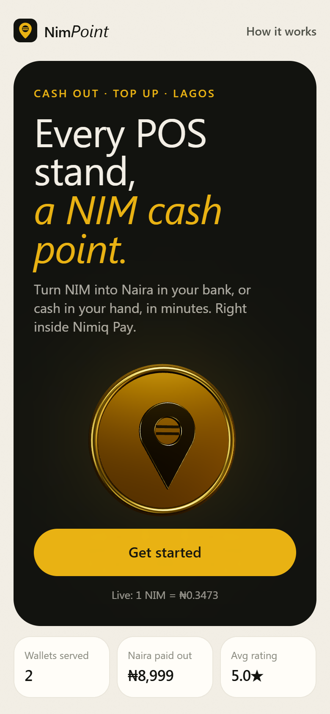 | 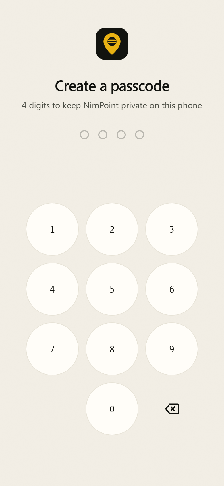 | 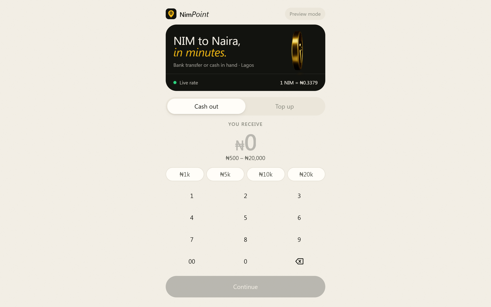 |
| **Landing.** What NimPoint is in one line, the 3D NimPoint coin, the live rate and live usage numbers. | **Passcode.** A 4-digit passcode like a banking app. Created once, then asked on every visit. Wrong tries are limited. | **Desktop preview.** On Mac or Windows the app shows a QR code that opens NimPoint inside Nimiq Pay. |
| 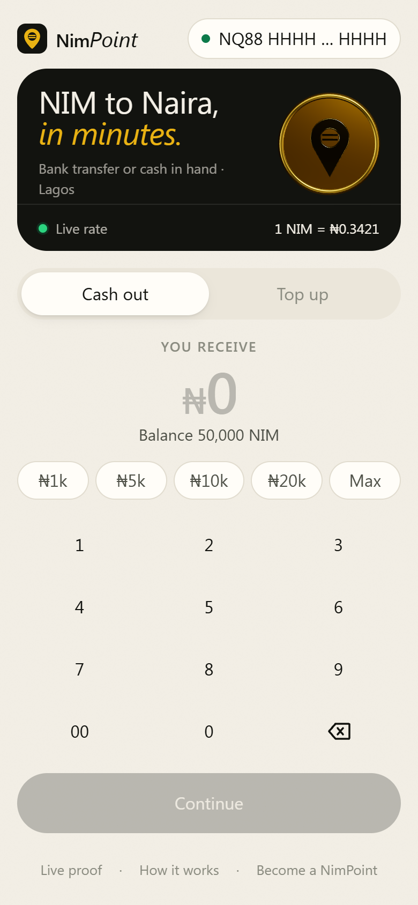 | 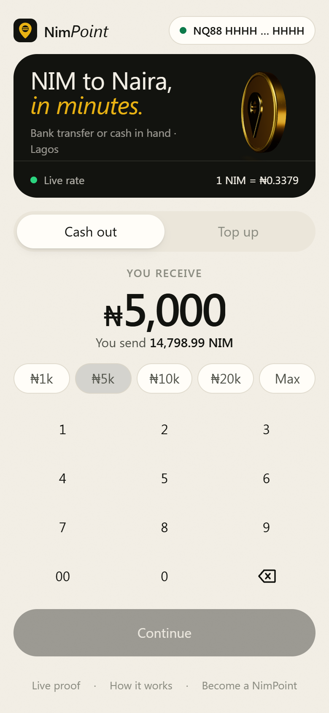 |  |
| **Home.** Live NIM→NGN rate, the 3D NimPoint coin and the connected Nimiq Pay wallet. | **Amount.** A big-thumb keypad (no system keyboard covering the screen). NIM needed is computed as you type. | **Bank or cash.** Remote bank payout, or cash in hand at a NimPoint stand. |
| 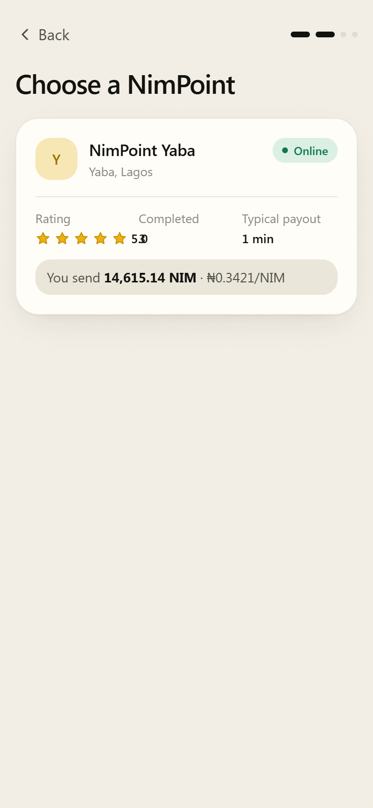 | 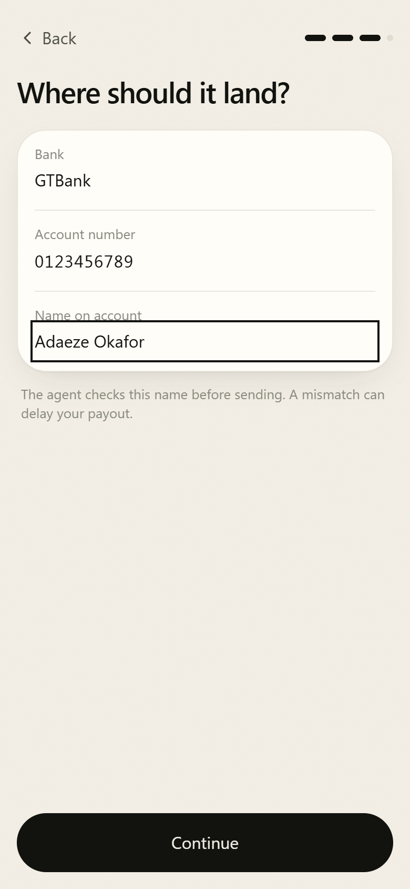 | 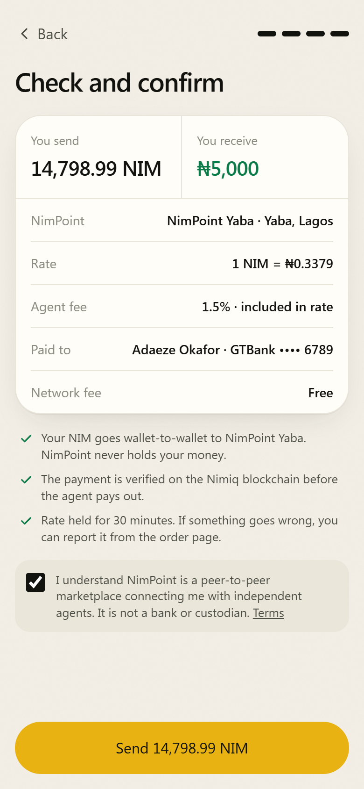 |
| **Pick an agent.** Online status, rating, completed orders, typical payout time and the exact NIM you'd send. | **Bank details.** All Nigerian banks and fintechs (OPay, PalmPay, Moniepoint, Kuda…). Saved for next time on your device only. | **Review.** Everything on one card: amounts, rate, agent fee, destination. One tap opens Nimiq Pay. |
| 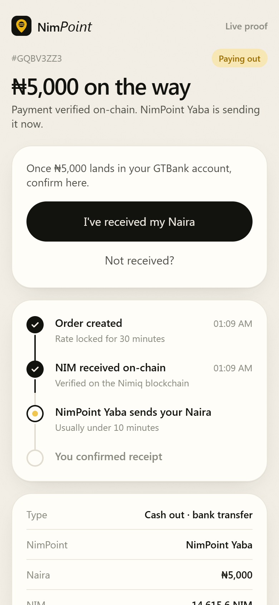 | 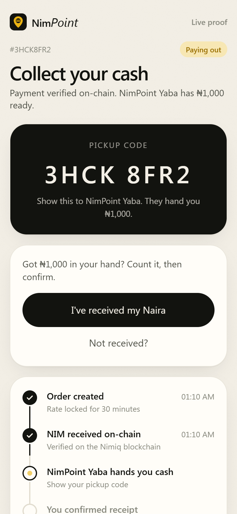 | 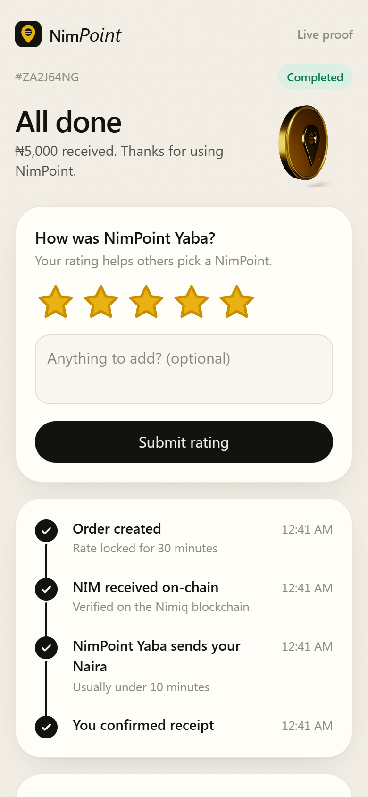 |
| **Verified on-chain.** Payment found by memo within seconds; the agent is alerted on Telegram. | **Cash pickup.** A large code to show the agent at the stand. | **Done.** Confirm receipt (optionally signed by your wallet) and rate the agent. |
| 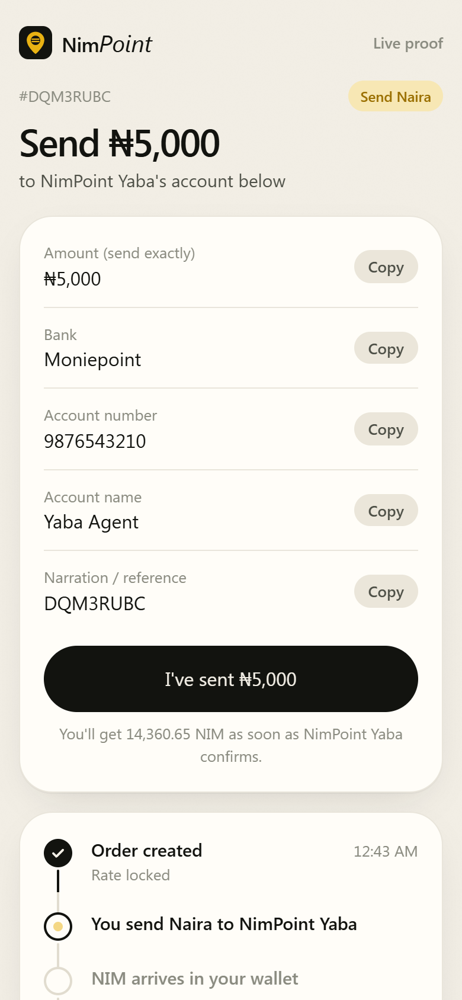 | 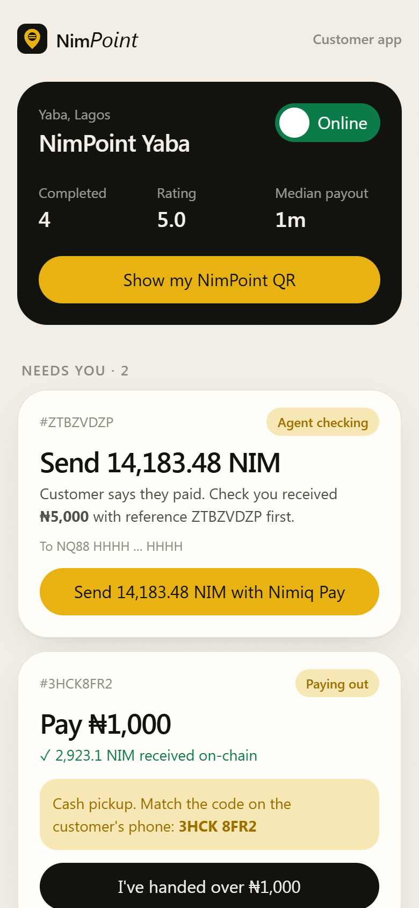 | 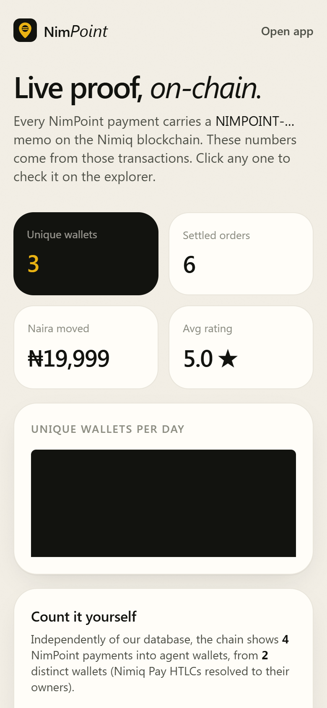 |
| **Top up.** Agent's account details with one-tap copy, and the exact reference to use. | **Agent console.** Online toggle, stats, to-do list and the printable NimPoint QR. | **Live proof.** Unique wallets, settled orders and every transaction, linked to the explorer. |

<p align="center">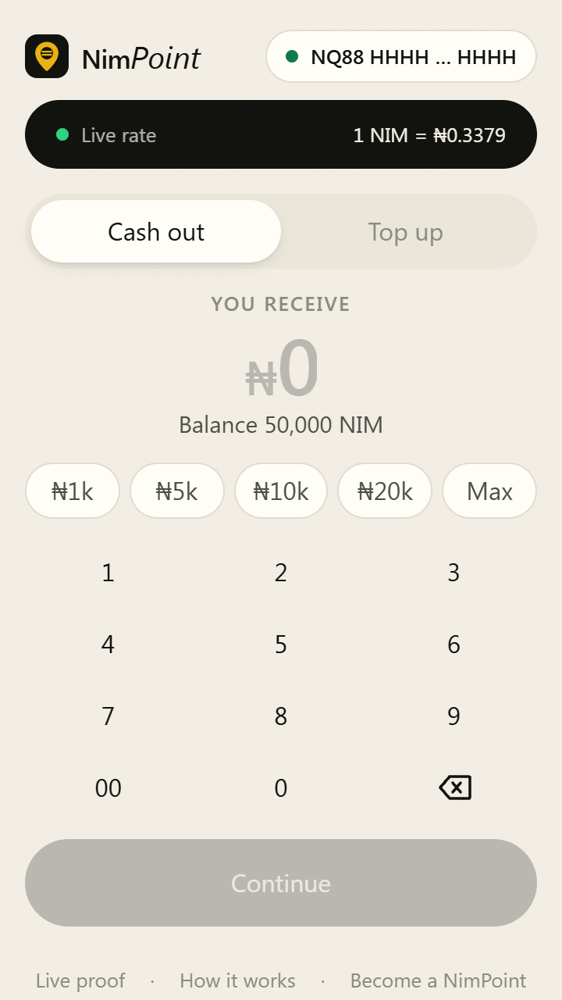<br/><sub>Fits a 360×640 Android screen without scrolling.</sub></p>

## How it works

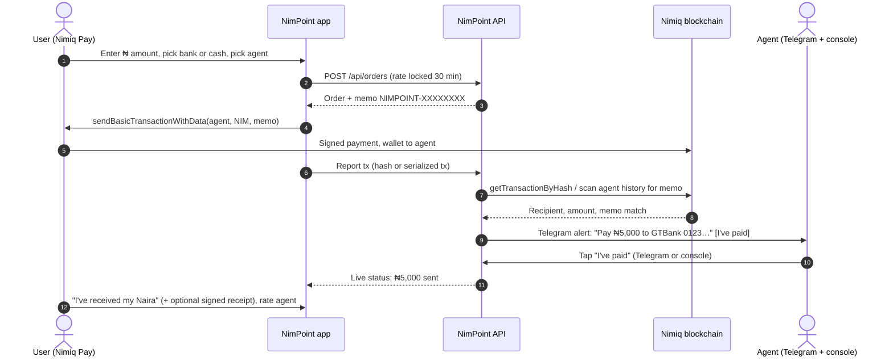

**Top-up** is the same in reverse: the user sends Naira (or hands over cash), taps "I've sent", and the agent sends NIM from the console with the same memo. NimPoint verifies it on-chain before showing it as arrived.

## Nimiq Pay integration

NimPoint uses the official [`@nimiq/mini-app-sdk`](https://www.npmjs.com/package/@nimiq/mini-app-sdk) throughout, beyond a simple payment:

| SDK feature | Where it's used |
| --- | --- |
| `init()` | Single shared provider, with a 4s timeout so desktop browsers fall back to "Open in Nimiq Pay" with a QR code. |
| `listAccounts()` | Identifies the user's wallet: order history, activity list, wallet chip. |
| `getBalance()` | Wallet + current HTLC balance: "Max" button and "you don't have enough" checks before paying. |
| `on('accountsChanged')` | Re-reads balance when Nimiq Pay rotates the HTLC. |
| `sendBasicTransactionWithData()` | Every payment, user→agent (cash-out) and agent→user (top-up), carries the order memo `NIMPOINT-XXXXXXXX`. |
| `sign()` | The user signs a one-line receipt (`NimPoint receipt Q3MN9MN7: I received ₦5,000 from NimPoint Yaba.`). Verified server-side with ed25519. |
| `NimiqProviderError` | Every wallet error type is mapped to plain words (cancelled, insufficient balance, outcome unknown). |
| `getHostNetwork()` | Each order records the wallet's network. Test-network orders are verified on the test network, labelled, and kept out of the real numbers. |
| Agents use Nimiq Pay too | The agent console is itself a Mini App page: agents pay top-ups with one tap from their own wallet. |

## Verifiable usage: the proof page

Real usage should be checkable, not claimed. `/proof` shows two independent counts:

0. **Registered users:** wallets that tapped "Register" and signed a fixed sentence with their Nimiq Pay key. The server checks the signature and that the key hashes to that address, so each one is a wallet somebody really holds.
1. **Ledger:** unique wallets, settled orders, Naira moved and average rating, plus a per-day chart and **every settled order with its transaction link** on [nimiq.watch](https://nimiq.watch).
2. **Chain-only:** the server scans each agent's address for incoming payments whose memo matches `^NIMPOINT-[2-9A-HJKMNP-Z]{8}$`, resolves each Nimiq Pay HTLC back to the owner wallet, and counts distinct owners.

The page has two tabs. **Real money (mainnet)** is the default and the only one that counts. **Test network** lists orders made from test-network wallets, which are labelled as tests everywhere and never added to the real numbers.

Anyone, including the Nimiq team, can rerun the chain count without trusting our server:

```bash
node scripts/count-users.mjs "NQ.. agent address"
# NimPoint payments on-chain: 31
# Unique paying wallets:      27
#   2026-11-10T09:12:44.000Z     2950.12 NIM  NIMPOINT-Q3MN9MN7  https://nimiq.watch/#…
```

## Safety model

Real money moves through this app, so every edge case has a rule:

| Situation | What NimPoint does |
| --- | --- |
| User closes the app right after paying | Payment is found by scanning the recipient's history for the memo. No hash needed. |
| Nimiq Pay returns a serialized tx, not a hash | Same memo scan. Verified in tests. |
| Wallet says "outcome unknown" | Treated as sent: the Pay button is hidden for 3 minutes while we watch the chain, so the user is never invited to pay twice. |
| Someone reuses an old transaction hash | A hash can settle exactly one order (atomic lock). |
| Wrong memo, right amount | Ignored. |
| User sends less than quoted | Payout recalculated from the NIM received at the locked rate, and explained on screen and to the agent. |
| Payment arrives after the 30-minute quote | Still honoured: we keep watching for 24 hours. |
| Double tap on "Send" | One order per wallet per 3 seconds; the button shows a spinner. |
| Agent goes offline | Hidden from new orders instantly. |
| Payout is late | "Not received?" reports it, alerts the agent on Telegram and keeps the on-chain record. |
| Rate API down | Last good rate is served (up to 6h) so the app never goes blank. |
| Nimiq node down | Multiple RPC URLs with failover and retry; a clear "your order is safe" message. |
| Database missing in production | Orders are refused with a clear message rather than silently lost. |
| Agent console | Secret key per agent, header-only, never in the browser bundle. |
| Agent takes the NIM and never pays | With bonds on, the customer reports it and NimPoint refunds them from that agent's bond. The agent's open orders can never add up to more than the bond. |
| Agent has no bond, or it is all in use | The agent is greyed out. The server refuses the order after reading the bond fresh from the chain. |
| Customer gets the Naira but never confirms | The order closes by itself 24 hours after the agent marked it paid, unless the customer reports a problem. The agent's record and bond are freed. |
| Customer lies about not being paid | NimPoint looks at the agent's proof of transfer and closes the report as "agent paid". |
| Wallet is on the Nimiq test network | The order is checked against the test network, marked TEST in red for the agent ("do not send real Naira"), and kept out of the real proof numbers. |
| Someone tries to inflate the user count | Registration needs a signature from the wallet's own key. An address typed into a form is not enough. |

### Agent bonds

Nimiq has no general smart contracts, so the bond is deliberately simple and fully visible:

1. The operator sets `BOND_ADDRESS`, a normal Nimiq wallet they control.
2. An agent sends NIM to it with the memo `NIMPOINT-BOND-<AGENT ID>`, in one tap from the agent console.
3. The bond is computed from the chain every time: deposits with that memo, minus payouts carrying `NIMPOINT-BONDOUT-<AGENT ID>`, and never more than the wallet really holds. The database is not trusted for it.
4. Every cash-out that is paid on-chain but not yet finished counts against the bond. A new cash-out is accepted only if it fits in what is left.
5. If a customer is not paid, the operator refunds them from the bond wallet (with the `BONDOUT` memo, so the agent's bond drops on-chain) and closes the report.

What this does and does not cover, honestly:

- It covers **cash-outs**, where the blockchain proves the agent received the customer's NIM.
- It does not cover **top-ups**. There the customer sends Naira first, and no blockchain can prove a bank transfer, so the agent checks their bank before sending NIM.
- Refunds are paid by the operator, by hand. The bond makes sure the money is there; it does not make the refund automatic.
- If several customers pay at the very same moment, exposure can briefly pass the bond, because a payment already on the blockchain cannot be refused.

Customer NIM still goes wallet-to-wallet and is never held by NimPoint. Agent bonds are the only funds NimPoint holds.

## Limits and open risks

NimPoint is honest about what it cannot do yet. A reader deciding whether to trust it should know these.

| Limit | Why it exists | What reduces it today |
| --- | --- | --- |
| **The Naira leg cannot be verified.** NimPoint sees every NIM payment on-chain, but it cannot see inside a bank. An agent could tap "I've sent" without sending. | The app is not connected to any bank or payment provider. | The agent's bond, the 24-hour report window, the public record and ratings. |
| **Top-ups are not covered by the bond.** The customer sends Naira first. | No blockchain can prove a bank transfer happened, so there is nothing objective to refund against. | Agents are vetted and added by the operator. Customers can report and the agent's record is public. |
| **Refunds are manual.** The operator pays them from the bond wallet by hand. | Nimiq has no general smart contracts to release a bond automatically. | Bond movements are on-chain with a fixed memo, so anyone can audit them. |
| **The operator holds the bond wallet.** Agents must trust the operator with their deposit. | Same reason: no contract can hold it. | The wallet is public, and each agent's balance can be recomputed from the chain. |
| **Agents are few and hand-picked.** There is no self-service sign-up. | Letting anyone become an agent before bonds are funded would put customers at risk. | Planned once bonds are in regular use. |
| **Small orders only.** ₦20,000 per order at most. | Keeps the loss small if something goes wrong while the network of agents is young. | Each agent can also set a lower limit. |
| **Rates move.** The rate is locked for 30 minutes, and the agent carries the price risk in that time. | NIM is volatile. | The agent's spread (1.5% by default) pays for it. |
| **Regulation.** Peer-to-peer crypto trading sits in a changing legal area in Nigeria. | Outside the app's control. | NimPoint never holds customer funds and does not present itself as a bank or exchange. Operators are responsible for following local rules. |
| **Real usage is still early.** | The app is new. | The proof page shows real-money and test-network activity on separate tabs, so nothing is overstated. |

## Architecture

```
src/
├─ app/
│  ├─ page.tsx                 Landing page (returning users skip straight to the app)
│  ├─ app/page.tsx             Passcode, then home + order flow (amount → method → agent → bank → review)
│  ├─ o/[id]/page.tsx          Live order page (pay, pickup code, confirm, rate, dispute)
│  ├─ agent/page.tsx           Agent console (Mini App page for agents)
│  ├─ proof/page.tsx           Public on-chain proof
│  ├─ how/page.tsx             How it works + plain-language terms
│  └─ api/
│     ├─ rate/                 GET live NIM/NGN mid rate
│     ├─ agents/               GET agents with live stats
│     ├─ orders/               POST create, GET list by wallet
│     ├─ orders/[id]/          GET (syncs with chain), POST actions
│     ├─ agent/                Agent console API (x-agent-key)
│     ├─ telegram/             Webhook ("I've paid" buttons) + /setup
│     ├─ users/                Signed wallet registration + count
│     ├─ admin/                Operator: close a reported order (x-admin-key)
│     └─ proof/                Ledger + chain-only usage stats, per network
├─ lib/
│  ├─ orders.ts                The order engine: state machine, chain sync, payouts, auto-complete
│  ├─ bond.ts                  Agent bonds, read from the chain by memo
│  ├─ users.ts                 Wallet registration (signature + address check)
│  ├─ nimiq-rpc.ts             Albatross JSON-RPC client with failover
│  ├─ nimiq-client.ts          Mini App SDK hook + payment/sign helpers
│  ├─ rates.ts                 CoinGecko rate with cache + stale fallback
│  ├─ store.ts                 Upstash Redis (prod) / in-memory (dev)
│  ├─ agents.ts                Agent registry from env, validated with zod
│  ├─ telegram.ts              Agent alerts (never throw)
│  └─ signature.ts             Nimiq signed-message verification (ed25519) and address-from-key
└─ components/                 UI kit, 3D coin, keypad, timeline, sheets
scripts/
├─ mock-nimiq.mjs              Local Nimiq node stand-in for tests
├─ e2e.mjs                     84 end-to-end API checks
└─ count-users.mjs             Independent on-chain user count
```

**Stack:** Next.js 15 (App Router) · React 19 · TypeScript (strict) · Tailwind CSS v4 · Motion · Three.js + React Three Fiber + drei · zod · Upstash Redis · Telegram Bot API · Vercel.

## Order lifecycle

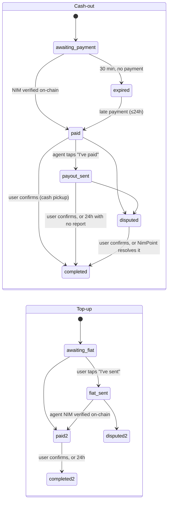

## API reference

All responses are JSON. Errors are `{ "error": "Plain sentence telling the user what to do." }`.

| Method | Path | Body / query | Description |
| --- | --- | --- | --- |
| GET | `/api/rate` | | `{ mid, usd, updatedAt, source }` NGN per NIM |
| GET | `/api/agents` | `?network=testnet` optional | Agents with `online`, `stats` and `bond` |
| POST | `/api/orders` | `{ kind, mode, agentId, wallet, ngn, bank?, network? }` | Create an order (rate locked, bond checked) |
| GET | `/api/orders?wallet=NQ..` | | Recent orders for a wallet (account numbers masked) |
| GET | `/api/orders/:id` | | Order + agent; syncs with the chain |
| POST | `/api/orders/:id` | `{ action: "tx", hash }` | Report a payment |
| POST | `/api/orders/:id` | `{ action: "fiat_sent" }` | Top-up: user sent Naira |
| POST | `/api/orders/:id` | `{ action: "confirm", receipt? }` | User received the money |
| POST | `/api/orders/:id` | `{ action: "rate", stars, comment? }` | Rate the agent |
| POST | `/api/orders/:id` | `{ action: "dispute", note? }` | Report a problem |
| GET | `/api/agent` | header `x-agent-key` | Agent dashboard |
| POST | `/api/agent` | `{ action: "online" \| "payout_sent" \| "nim_sent", … }` | Agent actions |
| POST | `/api/telegram` | Telegram update | Webhook (secret-token protected) |
| GET | `/api/telegram/setup?key=ADMIN_KEY` | | Registers the webhook |
| GET | `/api/proof` | `?network=testnet` optional | Public usage stats, registered users and bonds |
| GET | `/api/users?wallet=NQ..` | | Is this wallet registered, and how many are |
| POST | `/api/users` | `{ wallet, message, publicKey, signature, network? }` | Register a wallet with its own signature |
| POST | `/api/admin` | header `x-admin-key`, `{ action: "resolve", id, outcome }` | Operator closes a reported order: `agent_paid` or `refunded` |

## Run it locally

Requirements: Node.js 20+.

```bash
npm install
cp .env.example .env.local     # set AGENT_ADDRESS and AGENT_KEY at minimum
npm run dev                    # http://localhost:3000
```

In a normal browser the app runs in **preview mode** and shows an "Open in Nimiq Pay" QR. To test inside the wallet, deploy it (HTTPS is required) and open the URL in Nimiq Pay's Mini Apps; see the [Nimiq Mini Apps docs](https://nimiq.com/developers/mini-apps/mini-app-tutorial).

## Deploy to production

1. **Push to GitHub** (public, MIT). Live at **https://nimpoint.vercel.app**.
2. **Import into Vercel** → Framework: Next.js. No build settings needed.
3. **Add a database:** Vercel → Storage → Marketplace → **Upstash Redis** → connect to the project. This sets `KV_REST_API_URL` / `KV_REST_API_TOKEN`, which NimPoint reads automatically.
4. **Set environment variables** from [`.env.example`](.env.example): at least `AGENT_ADDRESS`, `AGENT_KEY` (long and random), `AGENT_NAME`, `AGENT_AREA`, plus `AGENT_BANK_*` to accept bank top-ups.
5. **Telegram alerts (recommended):**
   - Create a bot with [@BotFather](https://t.me/BotFather) → `TELEGRAM_BOT_TOKEN`.
   - Set `TELEGRAM_WEBHOOK_SECRET` and `ADMIN_KEY` to random strings, redeploy.
   - Open `https://YOUR-APP/api/telegram/setup?key=ADMIN_KEY` once.
   - Message your bot `/start`. It replies with your chat ID → `AGENT_TELEGRAM_CHAT_ID`, redeploy.
6. **Agent bonds (recommended):** create a wallet at [wallet.nimiq.com](https://wallet.nimiq.com), set `BOND_ADDRESS` to its address and redeploy. Each agent then opens `/agent` and taps **Add** on the bond card. Set `ADMIN_KEY` too, so you can close reported orders.
7. **Open the URL in Nimiq Pay** and do a small test cash-out to yourself. Use a wallet other than the agent's.
8. **Leave `NIMIQ_RPC_URL` unset** unless you run your own mainnet node. Test-network wallets are handled separately and automatically.
9. **Print your QR:** open `/agent`, enter your key, tap "Show my NimPoint QR".

## Become an agent

Agents are configured on the server, so only vetted people can receive orders. For several agents, set `AGENTS_JSON`:

```json
[
  {
    "id": "yaba-1",
    "name": "NimPoint Yaba",
    "area": "Yaba, Lagos",
    "address": "NQ.. .. ..",
    "key": "long-random-secret",
    "modes": ["bank", "cash"],
    "kinds": ["cashout", "topup"],
    "cashoutSpreadBps": 150,
    "topupSpreadBps": 150,
    "maxNgn": 20000,
    "bank": { "bankName": "Moniepoint", "accountNumber": "0123456789", "accountName": "Ada Agent" },
    "telegram": "@yaba_nimpoint",
    "telegramChatId": "123456789"
  }
]
```

Agents earn the spread (default 1.5%), shown to users before they pay.

When bonds are on, a new agent's first job is to post one: open the console, tap **Add** on the bond card and send NIM. Until the deposit confirms, customers see the agent greyed out with "No bond posted yet". The bond stays the agent's own money and is returned on-chain when they stop.

## Testing

| Suite | What it covers | Command |
| --- | --- | --- |
| Lint + types | ESLint (Next config), `tsc --noEmit` strict | `npm run lint && npm run typecheck` |
| End-to-end API (84 checks) | Validation, cash-out, top-up, memo scan, serialized tx, replay protection, wrong memo, short payment, disputes, ratings, agent auth, Telegram auth, offline agents, proof counts, idempotent creates, concurrent syncs, duplicate payments, send locks, **agent bonds** (no bond, wrong memo, capacity, release), **auto-complete**, **dispute resolution**, **signed registration** (forged and borrowed signatures refused) and **test-network separation** | `npm run test:e2e` (with mock node + app running; see [CONTRIBUTING](CONTRIBUTING.md)) |
| In-browser run | Registration, a full cash-out and a full top-up clicked through in headless Chrome with an injected Nimiq Pay provider, on three phones at once (two customers and the agent). This run produced the demo video's screens. | Not in CI |
| CI | Lint, typecheck, build and the full E2E suite on every push | [`.github/workflows/ci.yml`](.github/workflows/ci.yml) |
| CodeQL | Static security analysis weekly and on every PR | [`.github/workflows/codeql.yml`](.github/workflows/codeql.yml) |

## Design system

Inspired by the clarity of top consumer fintech, built for Lagos:

- **Palette:** warm bone paper `#f3efe6`, ink `#12130f`, NimPoint gold `#e9b213`, Naira green `#0d7a4a`. No neon gradients.
- **Type:** Geist for UI and numbers (tabular figures), Instrument Serif italics for warmth.
- **Logo:** an original mark, a gold location pin (a cash point near you) with the Naira double bar inside.
- **3D:** a gold NimPoint coin in React Three Fiber, lit with studio light-formers generated in code (no HDR download inside the webview). Falls back to an SVG coin if WebGL is unavailable.
- **Motion:** rolling digits, spring segmented controls, draggable bottom sheets, animated timeline. Enter-only page transitions so a throttled webview never shows a blank screen. `prefers-reduced-motion` respected.
- **Passcode:** a 4-digit device passcode (SHA-256 hashed, stored only on the phone) protects the app on shared phones. Five wrong tries trigger a 30-second lock. "Forgot passcode" resets it; funds are never at risk because they stay in Nimiq Pay.
- **Accessibility:** 16px+ inputs (no iOS zoom), 44px+ touch targets, ARIA labels on keypad, tabs, switches and ratings.

## Cross-platform support

| Platform | Experience |
| --- | --- |
| **iPhone (Nimiq Pay iOS)** | Full app. Safe-area insets for the notch and home bar, no input zoom, custom keypad. |
| **Android (Nimiq Pay Android)** | Full app, tested down to 360×640, with haptic tap feedback. |
| **Mac / Windows / Linux browsers** | Preview mode: browse rates and agents, plus a QR code that opens NimPoint inside Nimiq Pay on your phone. `/proof` and `/how` work fully. |

## Roadmap

- Account-name lookup before payout (bank verification API).
- USDT cash-outs once the Mini App SDK supports USDT transfers with data.
- Refunds paid from the bond automatically, once Nimiq Pay offers a co-signed or time-locked account a Mini App can drive.
- Naira payouts through a licensed payment provider, so the agent's transfer can be verified too.
- Self-service agent sign-up (agents are added by the operator today).
- Agent map with opening hours.
- Yoruba, Hausa, Igbo and Pidgin translations (the SDK already exposes the host language).

## Contributing, security and privacy

- [CONTRIBUTING.md](CONTRIBUTING.md): setup, tests and PR checklist
- [CODE_OF_CONDUCT.md](CODE_OF_CONDUCT.md)
- [SECURITY.md](SECURITY.md): private vulnerability reporting and design guarantees
- [PRIVACY.md](PRIVACY.md): exactly what we store and why

## License

[MIT](LICENSE) © NimPoint contributors. Built for the [Nimiq Mini Apps Competition](https://miniappscompetition.com) Cycle 3, On/Off-Ramp category.

> NimPoint is a peer-to-peer marketplace that connects users with independent agents. It is not a bank, exchange or custodian and never holds user funds.
