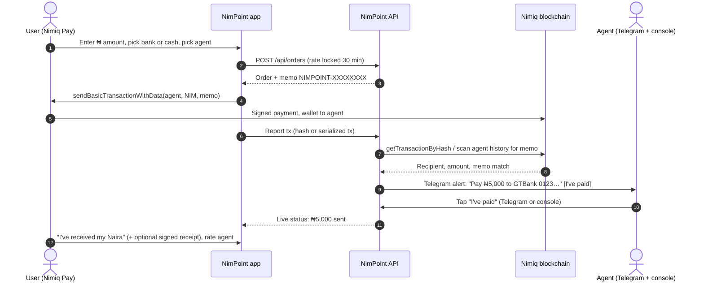
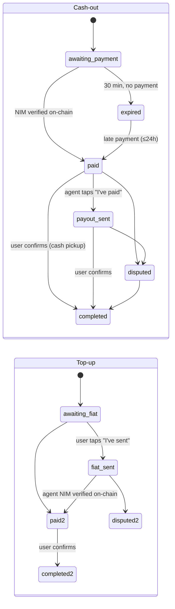

<div align="center">


# NimPoint

**Every POS stand, a NIM cash point.**
Cash out NIM to any Nigerian bank, or walk up to a NimPoint agent and leave with cash. Top up the same way. Every payment verified on the Nimiq blockchain.

[](../../actions/workflows/ci.yml)
[](../../actions/workflows/codeql.yml)
[](LICENSE)


[Live app](https://YOUR-DEPLOYMENT.vercel.app) · [Live on-chain proof](https://YOUR-DEPLOYMENT.vercel.app/proof) · [Demo video](#) · [Become a NimPoint](https://YOUR-DEPLOYMENT.vercel.app/agent)

</div>

---

## Table of contents

1. [The problem](#the-problem)
2. [The idea](#the-idea)
3. [What makes NimPoint different](#what-makes-nimpoint-different)
4. [Screenshots](#screenshots)
5. [How it works](#how-it-works)
6. [Nimiq Pay integration](#nimiq-pay-integration)
7. [Verifiable usage: the proof page](#verifiable-usage-the-proof-page)
8. [Safety model](#safety-model)
9. [Architecture](#architecture)
10. [Order lifecycle](#order-lifecycle)
11. [API reference](#api-reference)
12. [Run it locally](#run-it-locally)
13. [Deploy to production](#deploy-to-production)
14. [Become an agent](#become-an-agent)
15. [Testing](#testing)
16. [Design system](#design-system)
17. [Cross-platform support](#cross-platform-support)
18. [Roadmap](#roadmap)
19. [Contributing, security and privacy](#contributing-security-and-privacy)
20. [License](#license)

---

## The problem

Nimiq Pay can hold and send NIM, but **it cannot cash out or top up**. The Cycle 3 brief says it directly: _"it is not possible to top up or cash out from inside Nimiq Pay."_

In Nigeria, most people don't move money through exchanges. They walk to a **POS agent**: the kiosk on every street corner that turns a bank transfer into cash, and cash into a bank transfer, for a small fee. There are well over a million of them, and people trust them every day.

## The idea

**NimPoint turns those agents into NIM cash points.**

- **Cash out:** send NIM from Nimiq Pay, get Naira in your bank account _or_ cash in hand from an agent.
- **Top up:** pay an agent Naira (transfer or cash), receive NIM in your wallet.
- **Walk-up QR:** every agent gets a printable QR poster. Scan it at the stand and you're straight into that agent's checkout. Pay, show a pickup code, take your cash.

The category description asks for _"cash-out to bank or mobile money, merchant cash-in points."_ NimPoint is exactly that, built for the country where the agent model already works at scale.

## What makes NimPoint different

| | NimPoint |
| --- | --- |
| **Physical cash points** | Walk-up QR posters, cash-in-hand pickup codes and agents at real stands. Not just remote transfers. |
| **Agent console inside Nimiq Pay** | Agents run their whole business from the same wallet: online toggle, to-do list, one-tap NIM payouts, QR poster. |
| **Verifiable reputation** | Ratings and payout speed are computed from completed, on-chain-verified orders. The best agents rise to the top. |
| **Public, on-chain user proof** | `/proof` shows every settled order with its transaction link, plus a chain-only count anyone can rerun with one script. |
| **Never custodial, no smart-contract risk** | NIM goes wallet-to-wallet. No escrow contract, no treasury, nothing for us to lose. |
| **Built not to lose money** | Short payments, reused hashes, wrong memos, closed apps, uncertain wallet results and double taps are all handled. See [Safety model](#safety-model). |

## Screenshots

All screenshots were taken in an emulated phone viewport (390×844 @2x) against the production build. Wallet calls go to a simulated Nimiq node.

| | | |
| :---: | :---: | :---: |
|  |  |  |
| **Home.** Live NIM→NGN rate, the 3D NimPoint coin and the connected Nimiq Pay wallet. | **Amount.** A big-thumb keypad (no system keyboard covering the screen). NIM needed is computed as you type. | **Bank or cash.** Remote bank payout, or cash in hand at a NimPoint stand. |
|  |  |  |
| **Pick an agent.** Online status, rating, completed orders, typical payout time and the exact NIM you'd send. | **Bank details.** All Nigerian banks and fintechs (OPay, PalmPay, Moniepoint, Kuda…). Saved for next time on your device only. | **Review.** Everything on one card: amounts, rate, agent fee, destination. One tap opens Nimiq Pay. |
|  |  |  |
| **Verified on-chain.** Payment found by memo within seconds; the agent is alerted on Telegram. | **Cash pickup.** A large code to show the agent at the stand. | **Done.** Confirm receipt (optionally signed by your wallet) and rate the agent. |
|  |  |  |
| **Top up.** Agent's account details with one-tap copy, and the exact reference to use. | **Agent console.** Online toggle, stats, to-do list and the printable NimPoint QR. | **Live proof.** Unique wallets, settled orders and every transaction, linked to the explorer. |

<p align="center"><br/><sub>Fits a 360×640 Android screen without scrolling.</sub></p>

## How it works



**Top-up** is the same in reverse: the user sends Naira (or hands over cash), taps "I've sent", and the agent sends NIM from the console with the same memo. NimPoint verifies it on-chain before showing it as arrived.

## Nimiq Pay integration

NimPoint uses the official [`@nimiq/mini-app-sdk`](https://www.npmjs.com/package/@nimiq/mini-app-sdk) throughout, beyond a simple payment:

| SDK feature | Where it's used |
| --- | --- |
| `init()` | Single shared provider, with a 4s timeout so desktop browsers fall back to "Open in Nimiq Pay" with a QR code. |
| `listAccounts()` | Identifies the user's wallet: order history, activity list, wallet chip. |
| `getBalance()` | Wallet + current HTLC balance: "Max" button and "you don't have enough" checks before paying. |
| `on('accountsChanged')` | Re-reads balance when Nimiq Pay rotates the HTLC. |
| `sendBasicTransactionWithData()` | Every payment, user→agent (cash-out) and agent→user (top-up), carries the order memo `NIMPOINT-XXXXXXXX`. |
| `sign()` | The user signs a one-line receipt (`NimPoint receipt Q3MN9MN7: I received ₦5,000 from NimPoint Yaba.`). Verified server-side with ed25519. |
| `NimiqProviderError` | Every wallet error type is mapped to plain words (cancelled, insufficient balance, outcome unknown). |
| `getHostNetwork()` | Read on load for network awareness. |
| Agents use Nimiq Pay too | The agent console is itself a Mini App page: agents pay top-ups with one tap from their own wallet. |

## Verifiable usage: the proof page

Real usage should be checkable, not claimed. `/proof` shows two independent counts:

1. **Ledger:** unique wallets, settled orders, Naira moved and average rating, plus a per-day chart and **every settled order with its transaction link** on [nimiq.watch](https://nimiq.watch).
2. **Chain-only:** the server scans each agent's address for incoming payments whose memo matches `^NIMPOINT-[2-9A-HJKMNP-Z]{8}$`, resolves each Nimiq Pay HTLC back to the owner wallet, and counts distinct owners.

Anyone, including the Nimiq team, can rerun the chain count without trusting our server:

```bash
node scripts/count-users.mjs "NQ.. agent address"
# NimPoint payments on-chain: 31
# Unique paying wallets:      27
#   2026-11-10T09:12:44.000Z     2950.12 NIM  NIMPOINT-Q3MN9MN7  https://nimiq.watch/#…
```

## Safety model

Real money moves through this app, so every edge case has a rule:

| Situation | What NimPoint does |
| --- | --- |
| User closes the app right after paying | Payment is found by scanning the recipient's history for the memo. No hash needed. |
| Nimiq Pay returns a serialized tx, not a hash | Same memo scan. Verified in tests. |
| Wallet says "outcome unknown" | Treated as sent: the Pay button is hidden for 3 minutes while we watch the chain, so the user is never invited to pay twice. |
| Someone reuses an old transaction hash | A hash can settle exactly one order (atomic lock). |
| Wrong memo, right amount | Ignored. |
| User sends less than quoted | Payout recalculated from the NIM received at the locked rate, and explained on screen and to the agent. |
| Payment arrives after the 30-minute quote | Still honoured: we keep watching for 24 hours. |
| Double tap on "Send" | One order per wallet per 3 seconds; the button shows a spinner. |
| Agent goes offline | Hidden from new orders instantly. |
| Payout is late | "Not received?" reports it, alerts the agent on Telegram and keeps the on-chain record. |
| Rate API down | Last good rate is served (up to 6h) so the app never goes blank. |
| Nimiq node down | Multiple RPC URLs with failover and retry; a clear "your order is safe" message. |
| Database missing in production | Orders are refused with a clear message rather than silently lost. |
| Agent console | Secret key per agent, header-only, never in the browser bundle. |

NimPoint **never holds funds**. It's a peer-to-peer marketplace, and the app says so plainly before the first order.

## Architecture

```
src/
├─ app/
│  ├─ page.tsx                 Home + order flow (amount → method → agent → bank → review)
│  ├─ o/[id]/page.tsx          Live order page (pay, pickup code, confirm, rate, dispute)
│  ├─ agent/page.tsx           Agent console (Mini App page for agents)
│  ├─ proof/page.tsx           Public on-chain proof
│  ├─ how/page.tsx             How it works + plain-language terms
│  └─ api/
│     ├─ rate/                 GET live NIM/NGN mid rate
│     ├─ agents/               GET agents with live stats
│     ├─ orders/               POST create, GET list by wallet
│     ├─ orders/[id]/          GET (syncs with chain), POST actions
│     ├─ agent/                Agent console API (x-agent-key)
│     ├─ telegram/             Webhook ("I've paid" buttons) + /setup
│     └─ proof/                Ledger + chain-only usage stats
├─ lib/
│  ├─ orders.ts                The order engine: state machine, chain sync, payouts
│  ├─ nimiq-rpc.ts             Albatross JSON-RPC client with failover
│  ├─ nimiq-client.ts          Mini App SDK hook + payment/sign helpers
│  ├─ rates.ts                 CoinGecko rate with cache + stale fallback
│  ├─ store.ts                 Upstash Redis (prod) / in-memory (dev)
│  ├─ agents.ts                Agent registry from env, validated with zod
│  ├─ telegram.ts              Agent alerts (never throw)
│  └─ signature.ts             Nimiq signed-message verification (ed25519)
└─ components/                 UI kit, 3D coin, keypad, timeline, sheets
scripts/
├─ mock-nimiq.mjs              Local Nimiq node stand-in for tests
├─ e2e.mjs                     41 end-to-end API checks
└─ count-users.mjs             Independent on-chain user count
```

**Stack:** Next.js 15 (App Router) · React 19 · TypeScript (strict) · Tailwind CSS v4 · Motion · Three.js + React Three Fiber + drei · zod · Upstash Redis · Telegram Bot API · Vercel.

## Order lifecycle



## API reference

All responses are JSON. Errors are `{ "error": "Plain sentence telling the user what to do." }`.

| Method | Path | Body / query | Description |
| --- | --- | --- | --- |
| GET | `/api/rate` | | `{ mid, usd, updatedAt, source }` NGN per NIM |
| GET | `/api/agents` | | Agents with `online` and `stats` |
| POST | `/api/orders` | `{ kind, mode, agentId, wallet, ngn, bank? }` | Create an order (rate locked) |
| GET | `/api/orders?wallet=NQ..` | | Recent orders for a wallet (account numbers masked) |
| GET | `/api/orders/:id` | | Order + agent; syncs with the chain |
| POST | `/api/orders/:id` | `{ action: "tx", hash }` | Report a payment |
| POST | `/api/orders/:id` | `{ action: "fiat_sent" }` | Top-up: user sent Naira |
| POST | `/api/orders/:id` | `{ action: "confirm", receipt? }` | User received the money |
| POST | `/api/orders/:id` | `{ action: "rate", stars, comment? }` | Rate the agent |
| POST | `/api/orders/:id` | `{ action: "dispute", note? }` | Report a problem |
| GET | `/api/agent` | header `x-agent-key` | Agent dashboard |
| POST | `/api/agent` | `{ action: "online" \| "payout_sent" \| "nim_sent", … }` | Agent actions |
| POST | `/api/telegram` | Telegram update | Webhook (secret-token protected) |
| GET | `/api/telegram/setup?key=ADMIN_KEY` | | Registers the webhook |
| GET | `/api/proof` | | Public usage stats |

## Run it locally

Requirements: Node.js 20+.

```bash
npm install
cp .env.example .env.local     # set AGENT_ADDRESS and AGENT_KEY at minimum
npm run dev                    # http://localhost:3000
```

In a normal browser the app runs in **preview mode** and shows an "Open in Nimiq Pay" QR. To test inside the wallet, deploy it (HTTPS is required) and open the URL in Nimiq Pay's Mini Apps; see the [Nimiq Mini Apps docs](https://nimiq.com/developers/mini-apps/mini-app-tutorial).

## Deploy to production

1. **Push to GitHub** (public, MIT).
2. **Import into Vercel** → Framework: Next.js. No build settings needed.
3. **Add a database:** Vercel → Storage → Marketplace → **Upstash Redis** → connect to the project. This sets `KV_REST_API_URL` / `KV_REST_API_TOKEN`, which NimPoint reads automatically.
4. **Set environment variables** from [`.env.example`](.env.example): at least `AGENT_ADDRESS`, `AGENT_KEY` (long and random), `AGENT_NAME`, `AGENT_AREA`, plus `AGENT_BANK_*` to accept bank top-ups.
5. **Telegram alerts (recommended):**
   - Create a bot with [@BotFather](https://t.me/BotFather) → `TELEGRAM_BOT_TOKEN`.
   - Set `TELEGRAM_WEBHOOK_SECRET` and `ADMIN_KEY` to random strings, redeploy.
   - Open `https://YOUR-APP/api/telegram/setup?key=ADMIN_KEY` once.
   - Message your bot `/start`. It replies with your chat ID → `AGENT_TELEGRAM_CHAT_ID`, redeploy.
6. **Open the URL in Nimiq Pay** and do a ₦500 test cash-out to yourself.
7. **Print your QR:** open `/agent`, enter your key, tap "Show my NimPoint QR".

## Become an agent

Agents are configured on the server, so only vetted people can receive orders. For several agents, set `AGENTS_JSON`:

```json
[
  {
    "id": "yaba-1",
    "name": "NimPoint Yaba",
    "area": "Yaba, Lagos",
    "address": "NQ.. .. ..",
    "key": "long-random-secret",
    "modes": ["bank", "cash"],
    "kinds": ["cashout", "topup"],
    "cashoutSpreadBps": 150,
    "topupSpreadBps": 150,
    "maxNgn": 20000,
    "bank": { "bankName": "Moniepoint", "accountNumber": "0123456789", "accountName": "Ada Agent" },
    "telegram": "@yaba_nimpoint",
    "telegramChatId": "123456789"
  }
]
```

Agents earn the spread (default 1.5%), shown to users before they pay.

## Testing

| Suite | What it covers | Command |
| --- | --- | --- |
| Lint + types | ESLint (Next config), `tsc --noEmit` strict | `npm run lint && npm run typecheck` |
| End-to-end API (41 checks) | Validation, cash-out, top-up, memo scan, serialized tx, replay protection, wrong memo, short payment, disputes, ratings, agent auth, Telegram auth, offline agents, proof counts | `npm run test:e2e` (with mock node + app running; see [CONTRIBUTING](CONTRIBUTING.md)) |
| In-browser UI (20 checks) | Full cash-out, walk-up cash, top-up and agent flows clicked through in Chrome with an injected Nimiq Pay provider; 360×640 fit; no horizontal scroll; no double-pay on reload; desktop preview mode | Puppeteer script used to generate the screenshots |
| CI | Lint, typecheck, build and the full E2E suite on every push | [`.github/workflows/ci.yml`](.github/workflows/ci.yml) |
| CodeQL | Static security analysis weekly and on every PR | [`.github/workflows/codeql.yml`](.github/workflows/codeql.yml) |

## Design system

Inspired by the clarity of top consumer fintech, built for Lagos:

- **Palette:** warm bone paper `#f3efe6`, ink `#12130f`, NimPoint gold `#e9b213`, Naira green `#0d7a4a`. No neon gradients.
- **Type:** Geist for UI and numbers (tabular figures), Instrument Serif italics for warmth.
- **Logo:** an original mark, a gold location pin (a cash point near you) with the Naira double bar inside.
- **3D:** a gold NimPoint coin in React Three Fiber, lit with studio light-formers generated in code (no HDR download inside the webview). Falls back to an SVG coin if WebGL is unavailable.
- **Motion:** rolling digits, spring segmented controls, draggable bottom sheets, animated timeline. Enter-only page transitions so a throttled webview never shows a blank screen. `prefers-reduced-motion` respected.
- **Accessibility:** 16px+ inputs (no iOS zoom), 44px+ touch targets, ARIA labels on keypad, tabs, switches and ratings.

## Cross-platform support

| Platform | Experience |
| --- | --- |
| **iPhone (Nimiq Pay iOS)** | Full app. Safe-area insets for the notch and home bar, no input zoom, custom keypad. |
| **Android (Nimiq Pay Android)** | Full app, tested down to 360×640, with haptic tap feedback. |
| **Mac / Windows / Linux browsers** | Preview mode: browse rates and agents, plus a QR code that opens NimPoint inside Nimiq Pay on your phone. `/proof` and `/how` work fully. |

## Roadmap

- Account-name lookup before payout (bank verification API).
- USDT cash-outs once the Mini App SDK supports USDT transfers with data.
- Agent bonds and auto-suspension after disputes.
- Agent map with opening hours.
- Yoruba, Hausa, Igbo and Pidgin translations (the SDK already exposes the host language).

## Contributing, security and privacy

- [CONTRIBUTING.md](CONTRIBUTING.md): setup, tests and PR checklist
- [CODE_OF_CONDUCT.md](CODE_OF_CONDUCT.md)
- [SECURITY.md](SECURITY.md): private vulnerability reporting and design guarantees
- [PRIVACY.md](PRIVACY.md): exactly what we store and why

## License

[MIT](LICENSE) © NimPoint contributors. Built for the [Nimiq Mini Apps Competition](https://miniappscompetition.com) Cycle 3, On/Off-Ramp category.

> NimPoint is a peer-to-peer marketplace that connects users with independent agents. It is not a bank, exchange or custodian and never holds user funds.
